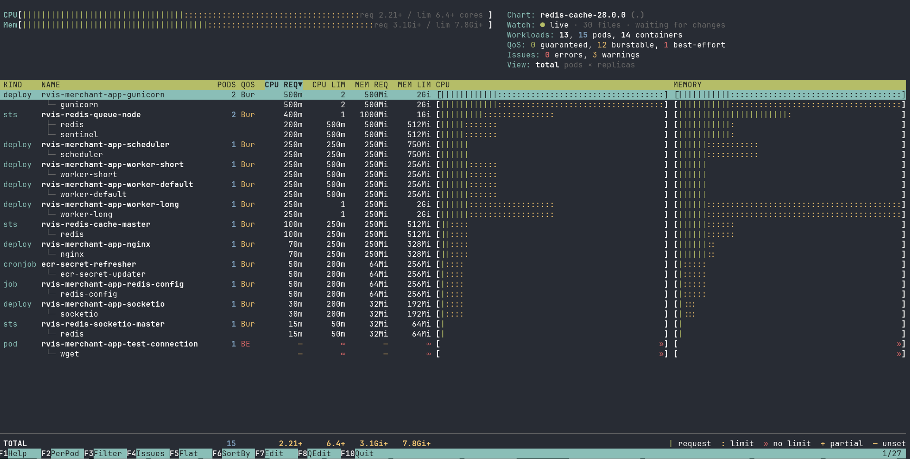

# rvis

[](https://github.com/mohammed-ehsan/rvis/actions/workflows/ci.yml)
[](LICENSE)

**rvis** is a Helm plugin that shows the CPU and memory **requests and limits** of a Helm chart in an interactive, htop-style terminal view, and lets you edit them in place.

Point it at a chart and it renders the manifests. For every workload and container it shows requests, limits and replicas, plus the effective size of each pod and the totals for the whole chart, before anything is deployed. When you change a value, rvis writes it back to the exact line of the chart where it is defined.



## Features

- **htop-style view:** meters for chart totals, a table of workloads and their containers with bars on a shared scale, sorting, filtering and a detail panel per workload.
- **Correct pod math:** follows the Kubernetes scheduler's rules for init containers and native sidecars, requests that default to limits, replicas, autoscalers (HPA min and max), Jobs, CronJobs and DaemonSets. Memory is shown in the units the chart uses (`3G` stays `3G`).
- **Edit in place:** change requests, limits and replica counts from the UI. rvis finds where each value is defined (`values.yaml`, a `-f` override file or a template literal) and changes only that value, keeping comments and formatting.
- **Quick edit:** turn the whole table into a spreadsheet and watch the totals change as you type. Save every change in one pass.
- **Live reload:** the view updates whenever you save a file in the chart.
- **Findings:** flags missing requests or limits, limits below requests, and memory written in decimal units.
- **Scriptable:** `-o table` for CI logs, `-o json` for scripts, and `--fail-on` to fail a pipeline on misconfigured containers.

## Requirements

- [Helm](https://helm.sh/docs/intro/install/) 3 (tested with 3.18)
- Linux or macOS. The install hook needs a POSIX shell.
- [Go](https://go.dev/dl/) 1.26 or newer, only to build from source

## Installation

### From GitHub

```sh
helm plugin install https://github.com/mohammed-ehsan/rvis
```

If Go is available, the install hook builds rvis from source. Otherwise it downloads the prebuilt binary for your platform from the [latest release](https://github.com/mohammed-ehsan/rvis/releases).

To update or remove the plugin:

```sh
helm plugin update rvis
helm plugin uninstall rvis
```

### From a local checkout (no network needed)

```sh
git clone https://github.com/mohammed-ehsan/rvis.git
cd rvis
make install-local
```

This builds rvis and copies a self-contained plugin into Helm's plugin directory. Running it again replaces the installed version.

### For a machine without internet access

On a machine with Go, build a package (set `GOOS`/`GOARCH` to target another platform):

```sh
make package                 # dist/rvis_<version>_<os>_<arch>.tar.gz
GOOS=darwin GOARCH=arm64 make package
```

Copy the archive to the target machine, then:

```sh
tar -xzf rvis_<version>_<os>_<arch>.tar.gz
helm plugin install ./rvis
```

Check the installation with `helm rvis --rvis-version`.

## Quick start

```sh
# A local chart with your values (flags are passed to `helm template`)
helm rvis ./mychart -f values.yaml -f values.prod.yaml

# A chart from a repository, with the meters sized to a 16 core / 64Gi node
helm rvis bitnami/redis --cpu 16 --memory 64Gi

# A release that is already installed
helm rvis --release my-app -n production

# CI: print a table and fail if a container is misconfigured
helm rvis ./mychart -o table --fail-on error
```

In the interactive view:

| Key | Action |
| --- | --- |
| `↑` `↓` `Enter` | Move the selection and open the detail panel |
| `F7` / `e` | Edit the selected workload's requests, limits and replicas |
| `F8` / `E` | Quick edit: the whole table, with totals updating as you type (`Ctrl+S` saves) |
| `F3` / `/` | Filter |
| `F6` / `s` | Change the sort column |
| `F2` / `r` | Toggle total footprint / single pod |
| `F1` / `?` | Help and legend |
| `F10` / `q` | Quit |

See the **[user guide](docs/USAGE.md)** for the full reference: every flag and key, live reload, both edit modes, how values are traced to their source, and how the numbers are computed.

## Development

```sh
make build      # bin/rvis
make test       # unit tests (the edit tests need helm on PATH)
make lint       # gofmt and go vet
make demo       # interactive view of the bundled demo chart
```

Releases are built by [GoReleaser](https://goreleaser.com) when a `v*` tag is pushed (see `.github/workflows/release.yml`). Keep the version in `plugin.yaml` in step with the tag, because the install hook downloads the release that matches it.

Contributions are welcome. Please open an issue to discuss larger changes, and run `make lint test` before sending a pull request.

## License

rvis is released under the [MIT License](LICENSE).
